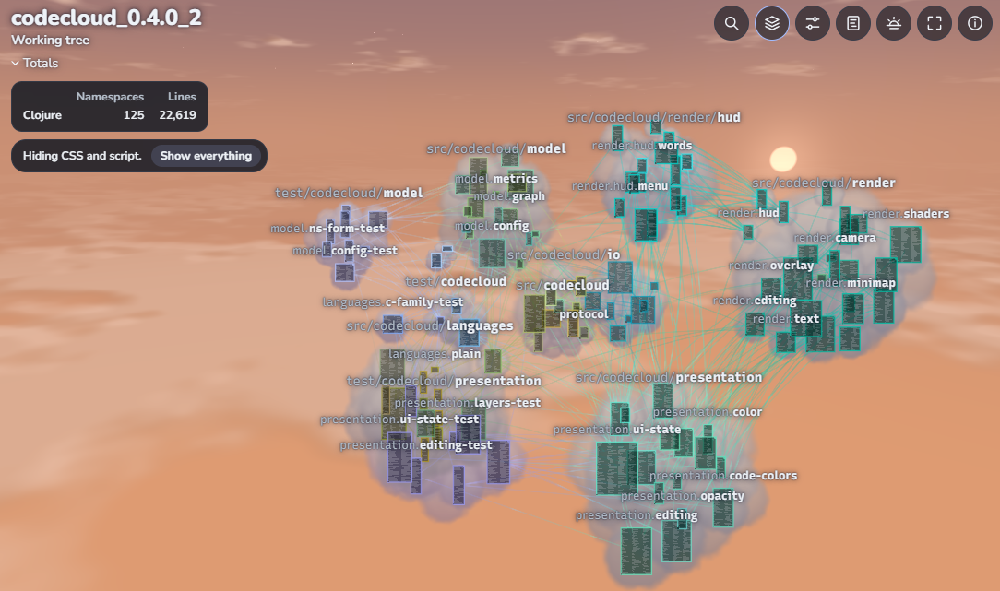
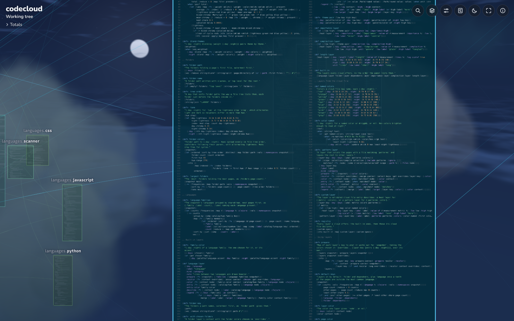
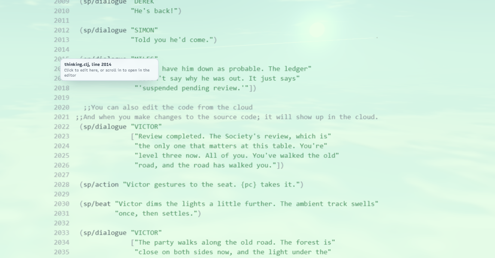
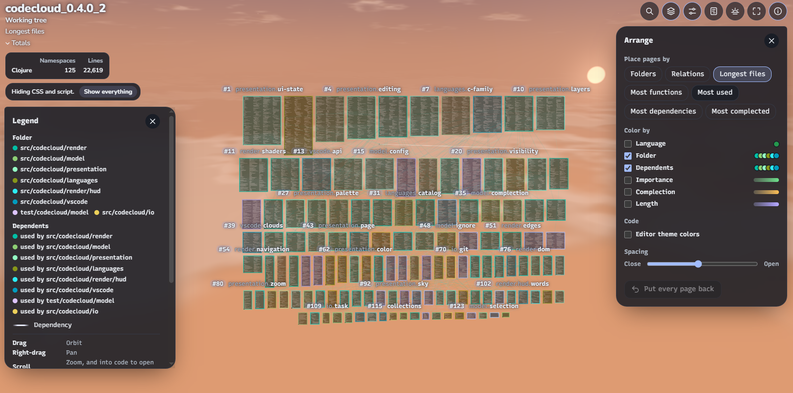
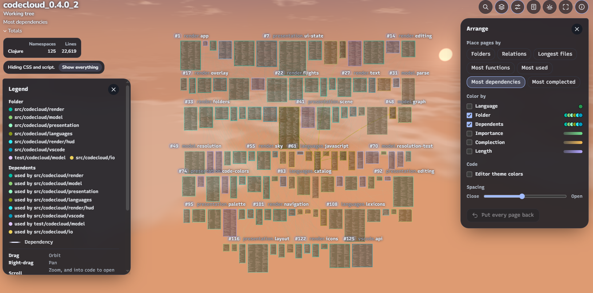
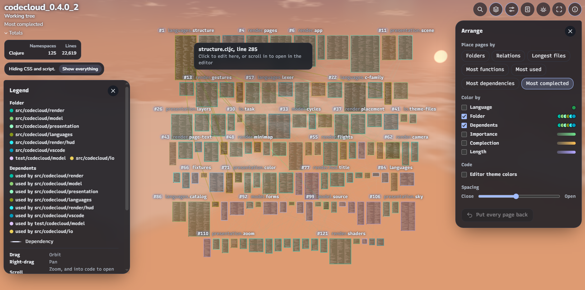
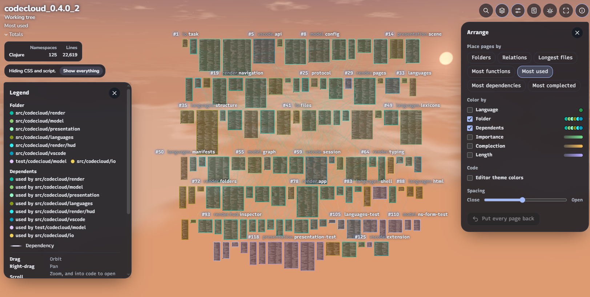

# CodeCloud

CodeCloud is a VS Code extension that renders any codebase as pages of real code floating in an idyllic sky. Every source file becomes a page set in the editor's own font, the pages of each folder gather in clouds with lines joining each page to it's dependencies. 

Zooming out of a file opens the cloud on the same line, and zooming into a page opens its file in a standard vs code window.

Cloud view lets you see your code in context, and even lets you edit the code from the sky view. Give it a try!

Forever free, forever open source, forever opposed to exploitation and oligarchy. Let no one control code.



>                             **Built using LLMs in conjunction with my brain.**
>                       **Advance the transhuman agenda - surrender your brain, today!**
                                                      :)

## Getting started

0. I literally included the .vsix file in extensions/vsix/. It is completely built there and good to go so you should just be able to install it and begin using the program right away.
   - I plan on publishing this on the vscode extension marketplace, so hopefully at some point you will just be able to install it via that!!
   - Until then if you want to alter the source code and rebuild it on your own machine or whatever, you can do the following things:

1. Install CodeCloud and open a folder of code. Until a registry lists it, install the `.vsix` with **Extensions: Install from VSIX...**.
2. Run **CodeCloud: Enter Cloud View** from the command palette, or click the cloud button in a source file's title bar.
3. Accept the offer to create `codecloud.cld`, the cloud file, in the nearest project folder.

## At a glance

| | |
| --- | --- |
| Version | 0.4.0, pre-alpha |
| Languages highlighted | 19 |
| Languages read in depth* | 9 |
| Arrangements** | 7 |
| Color layers | 6 built in, plus any the cloud file defines |
| Skies | 5 |
| Source | 19,800 lines of Clojure and ClojureScript in 104 namespaces, 50 of them as `.cljc` files |
| Tests | 126 tests, 32,324 assertions |
| Download | 1.6 MB |
| Network use | None; analysis runs on the local machine |

> *Q: "What does 'in depth' mean? \
> *A: In depth, above, refers to the fact that this program requires adapters for each language that you want to be able to edit in the cloud view. "Languages Highlighted" means it will interpret those files as source codde, but it does not yet have the ability to edit the code from the cloud view. -Those programs are listed later in this readme. \
> **Q: "What is an 'arrangement'?"
> **A: An 'arrangement' here, refers to a ranking/sorting of the files based on arbitrary heuristics that I have incorporated with this program (a list of the base arrangements will be provided further down the readme). This program is designed to be extensible so that if you have the question "Which of my namespaces is making the most database calls"? The code should be able to follow whatever heuristic you think is fitting (ie, if it isn't included, youu have to make it, but it shouldn't be too hard). The plan is to create more heuristics over time, as this is a major feature of this program.

| Codebase | Language | Files | Lines | Full analysis |
| --- | --- | --- | --- | --- |
| malli 0.20.3 | Clojure | 100 | 23,307 | 4.1 s |
| clj-kondo 2026.10.26 | Clojure | 490 | 55,573 | 4.8 s |
| Lua 5.5.1 | C | 103 | 52,880 | 6.2 s |
| LevelDB 1.23 | C++ | 134 | 29,405 | 5.6 s |

`node dist/cli.js summary` measured these times in a Linux container.

## Features

| Feature | Description |
| --- | --- |
| Pages of real code | Each file drawn at the editor's font and size, a minimap from afar |
| Folder clouds | A folder's pages gathered in a cloud tinted with its color |
| Dependency lines | From each page to what it requires, imports, includes, loads, or runs, shaded from one end's color to the other's and heavier across languages |
| Cycles and errors | Pulsing red for Clojure dependency cycles, amber for import loops a language allows, bright red for files that fail to parse |
| Arrangements | Folders, Relations, and ranked walls by **length, functions, uses, dependencies, or complection*** |
| Color layers | Language, Folder, Dependents, Importance, Complection, and Length, blended on each page, plus custom layers and colors |
| Complection | A score for each definition from its length, branches, nesting, asynchronous work, state changes, and flagged names |
| Editing in the cloud | A click on readable code places a caret, and each change reaches VS Code's document unsaved |
| Zoom portal | Ctrl+- from a file into the cloud at the same line, and a scroll into a page opens its file |
| Editor theme colors | The theme's syntax colors, font styles, and bracket pair colors, fitted to either sky |
| History | Recent commits, stepped through or played, with pages moving as the code changes |
| Views and filters | Named views, toggles for each language, folder, and page, and **Save view** |
| Finding and reading | Search, a names-only mode, an inspector, totals by language, a legend, and context menus |
| Layout by hand | Pages moved anywhere and spacing opened or closed, remembered for each cloud |
| Sky | Day, twilight, night, the clock, or the editor theme's lead, with birds and airplanes, and a still sky for reduced motion |

> *-Note that the above arrangements are the currently included arrangements of files.



## Languages

| Language | One page per | Lines come from | Definitions |
| --- | --- | --- | --- |
| Clojure, ClojureScript, Babashka | Namespace | Requires, string requires of JavaScript, Java imports, and scripts run by `shell`, `sh`, or `process` | Every `def` form |
| Python | Module | `import` and `from`, relative imports included | Functions, classes, methods, constants |
| JavaScript, TypeScript | File | `import`, `export from`, `require`, `import()`, and `tsconfig.json` aliases | Functions, classes, methods, constants |
| CSS, SCSS, Sass, Less | Style sheet | `@import`, `@use`, `@forward` | Sass mixins, functions, variables |
| HTML | Page | Scripts, style sheets, modules, and local links | None |
| Shell | Script | `source`, `.`, and scripts run by path or interpreter | Functions |
| C, C++ | Source file, with its header | `#include`, through the include folders that `compile_commands.json`, CMake, Make, Meson, and `:include-paths` name | Functions, methods, operators, types, macros, constants, and tests, read with tree-sitter |

Java, Kotlin, C#, Go, Rust, Ruby, PHP, Lua, R, and Julia show as highlighted pages without lines, and the Language layer marks them unclassified.

## Controls

| Input | Action |
| --- | --- |
| Drag | Orbit |
| Right-drag or Shift-drag | Pan |
| Scroll | Zoom toward the pointer; past editor size, open the file at that line |
| Click a page or folder cloud | Bring it closer |
| Double-click | Fly there |
| Ctrl-drag or Alt-drag | Move a page |
| Click readable code | Edit in place; Esc stops |
| Right-click | Actions for the page, folder, or sky |
| `/`, `N`, `A`, `?` | Search, names only, arrange panel, legend |
| `[` and `]` | Close the cloud up or open it out |
| Home | Show the whole cloud |
| Left and right arrows, Space | Step through history, play it |
| Ctrl+- and Ctrl+= (Cmd on macOS) | Zoom from a file into its cloud and back |



## Settings

| Setting | Default | Meaning |
| --- | --- | --- |
| `codecloud.zoomOutThreshold` | 150 | How far, in percent, the editor zooms out before the cloud opens |
| `codecloud.useStandardZoomKeys` | true | Ctrl+- and Ctrl+= zoom covered files toward the cloud and back |
| `codecloud.sky` | auto | `auto`, `day`, `twilight`, `night`, or `clock` |
| `codecloud.editorColors` | false | Draw code in the editor theme's colors |
| `codecloud.historyLimit` | 60 | Most commits on the timeline |

## Commands

| Command | Action |
| --- | --- |
| Enter Cloud View | Open the current file's cloud, or offer to create one |
| Zoom Out Toward the Cloud, Zoom Back In | One step of the zoom keys |
| Create Cloud Here, Edit Cloud Settings, Refresh Cloud | Make, open, or reread a cloud file |
| Show Only These in the Cloud, Hide in the Cloud, Show Everything in the Cloud | Filter from the explorer |

## The cloud file

`codecloud.cld` is an EDN map covering the folder that holds it, and every key is optional. `deps.edn` may carry the same map under `:codecloud/config`.

| Key | Meaning |
| --- | --- |
| `:include`, `:ignore` | `.gitignore` patterns narrowing the cloud |
| `:views` | Named parts of the cloud |
| `:languages`, `:extensions` | Languages or file types to read |
| `:flags`, `:complection` | What counts toward complection, and its thresholds |
| `:weights` | What counts toward importance |
| `:color-layers` | Extra color layers |
| `:include-paths` | More C and C++ include folders |

## Status

| Version | Shipped |
| --- | --- |
| 0.1.0 | Pages, folder clouds, dependency lines, cloud files, the zoom portal, views, search, history |
| 0.2.0 | Arrangements, complection, gradient lines, spacing, movable pages, a living sky |
| 0.3.0 | Search results and complection thresholds in the cloud file |
| 0.3.1 | Non-clojure files are counted as pages; Python, JavaScript, TypeScript, CSS, HTML, and shell read in depth |
| 0.3.2 | Color layers |
| 0.3.3 | The views panel, the color chooser, editing in the cloud, the twilight sky, tinted clouds |
| 0.4.0 | C and C++ through tree-sitter, editor theme colors, faster analysis |

| TODOs | State |
| --- | --- |
| Java, Kotlin, C#, Go, Rust, Ruby, PHP, Lua, R, Julia | Highlighted only; adapters planned |
| Architecture view of components and interop seams | Planned |
| Export of what the cloud shows for AI tools | Planned |
| Role highlighting of state, logic, models, and views | Planned |
| Workbench, a full-screen editor with the cloud in a corner | Stretch goal |
| Listing in an extension registry | Not yet published |

| Known limit | Effect |
| --- | --- |
| Themes kept in `.tmTheme` files | Editor theme colors fall back to CodeCloud's own |
| Semantic highlighting from language servers | Not drawn on pages |
| Control and declaration keywords | Share one color on pages |
| `#if 0` blocks in C and C++ | Read as live code |
| Macros that open or close braces | Can misplace where a C or C++ definition ends |
| History and highlighted-only languages | Read-only |

## Building from source

The build calls the ClojureScript compiler directly and bundles with esbuild. It needs a JDK, the Clojure CLI, and Node.js 18 or newer.

```shell
npm install
clojure -M:build release            # dist/extension.js and dist/webview.js
clojure -M:build test               # tests on Node
npx vsce package                    # codecloud-0.4.0.vsix
clojure -M:build cli harness        # command-line analyzer and browser harness
node dist/cli.js summary path/to/project
node dist/cli.js bundle path/to/project --history 20   # then open dev/index.html?data=project
```

| Namespace | Role |
| --- | --- |
| `codecloud.languages` | The catalog, one lexer with a lexicon per language, and an adapter per language |
| `codecloud.model` | Reading, import resolution, the graph, and measurements, all portable `.cljc` |
| `codecloud.presentation` | The view model as pure functions |
| `codecloud.render` | three.js drawing, input, and panels |
| `codecloud.io`, `codecloud.vscode` | Files, git, tree-sitter, and the VS Code host |
| `codecloud.protocol` | EDN messages between view and host |

## Some more pretty pictures (demonstrating 'arrangements')!!






## License

MIT; see [LICENSE](LICENSE). The bundled fonts, Recursive and Nunito, are under the SIL Open Font License, and the tree-sitter runtime and its C and C++ grammars are under the MIT License, with notices in `media/fonts` and `grammars/LICENSE.txt`.
