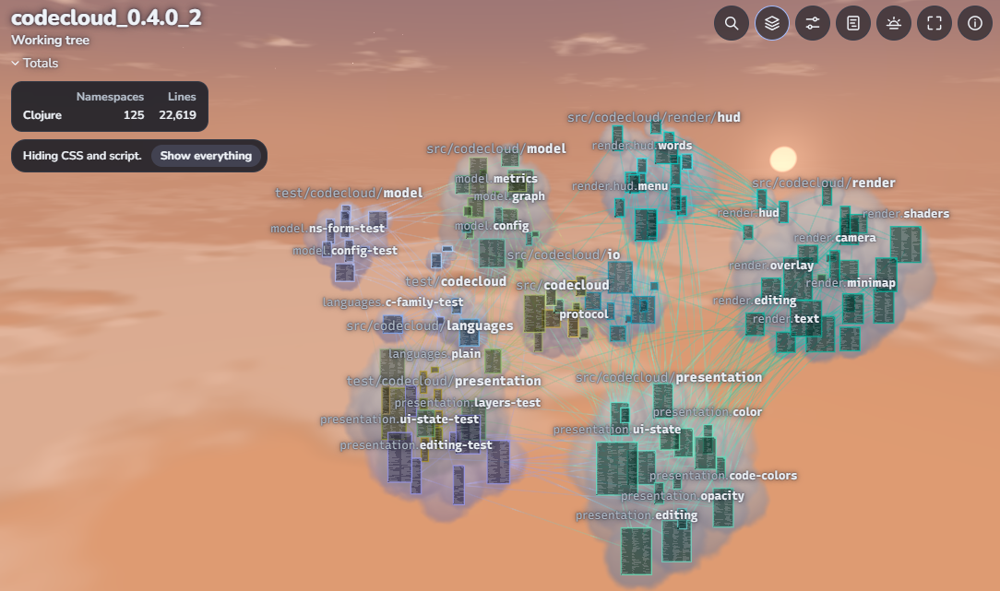
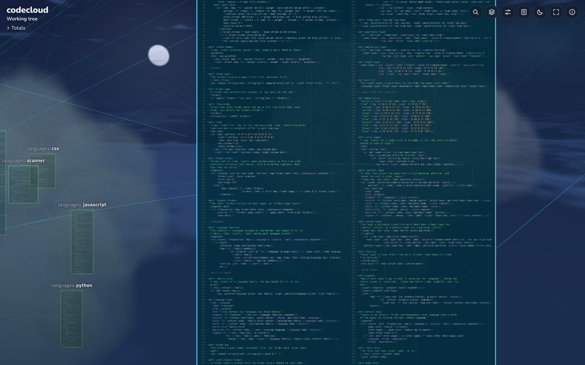
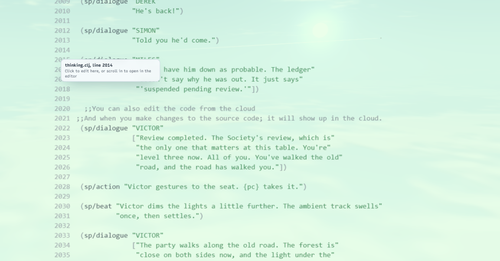
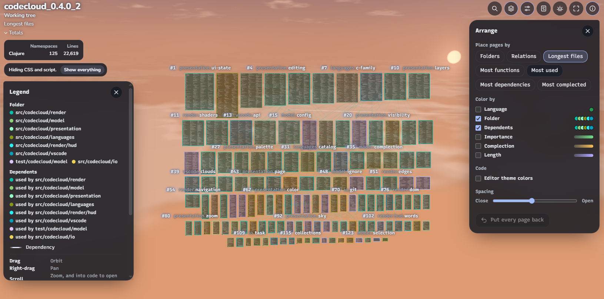
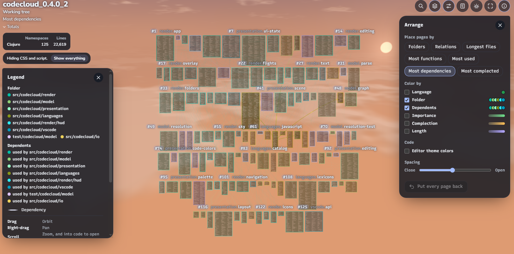
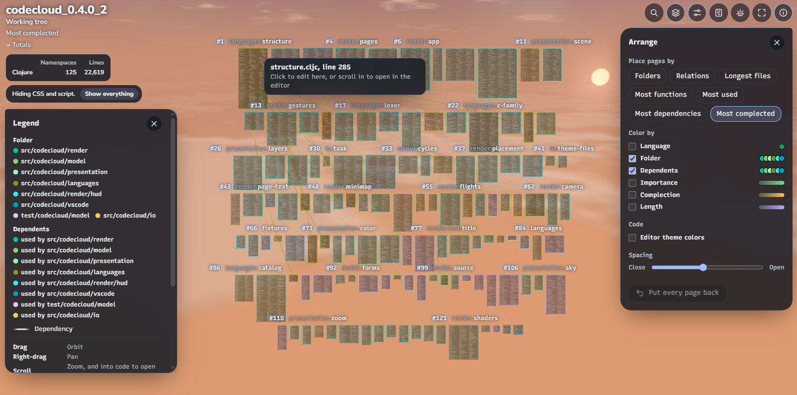
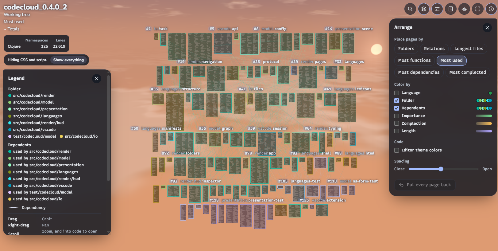

# CodeCloud

CodeCloud is a VS Code extension that renders any codebase as pages of real code floating in an idyllic sky. Every source file becomes a page set in the editor's own font, the pages of each folder gather in clouds with lines joining each page to its dependencies.

Zooming out of a file opens the cloud on the same line, and zooming into a page opens its file in a standard VS Code window.

Cloud view lets you see your code in context, and even lets you edit the code from the sky view. Give it a try!

Forever free, forever open source, forever opposed to exploitation and oligarchy. Let no one control code.



>                             **Built using LLMs in conjunction with my brain.**
>                       **Advance the transhuman agenda - surrender your brain, today!**
                                                      :)

## Getting started

0. I literally included the .vsix file in extensions/vsix/. It is completely built there and good to go so you should just be able to install it and begin using the program right away.
   - I plan on publishing this on the vscode extension marketplace, so hopefully at some point you will just be able to install it via that!!
   - Until then if you want to alter the source code and rebuild it on your own machine or whatever, **Building from source** below shows how. Either way, you can do the following things:

1. Install CodeCloud and open a folder of code. Until a registry lists it, install the `.vsix` with **Extensions: Install from VSIX...**.
2. Run **CodeCloud: Enter Cloud View** from the command palette, or click the cloud button in a source file's title bar.
3. Accept the offer to create `codecloud.cld`, the cloud file, in the nearest project folder.

## At a glance

| | |
| --- | --- |
| Version | 0.4.2, pre-alpha |
| Languages highlighted | 19 |
| Languages read in depth* | 9 |
| Arrangements** | 7 |
| Color layers | 6 built in, plus any the cloud file defines |
| Environments | 7 built in, plus rooms described in settings |
| Source | 33,100 lines of Clojure and ClojureScript in 165 namespaces, 80 of them as `.cljc` files |
| Tests | 292 tests, 33,548 assertions |
| Download | 2.0 MB |
| Network use | None by default; analysis runs on the local machine, the agent hub listens only on 127.0.0.1, and the assistant talks only to the model provider you add |

> *Q: "What does 'in depth' mean?" \
> *A: In depth, above, refers to the fact that this program requires adapters for each language that you want to be able to edit in the cloud view. "Languages Highlighted" means it will interpret those files as source code, but it does not yet have the ability to edit the code from the cloud view. -Those programs are listed later in this readme. \
> **Q: "What is an 'arrangement'?"
> **A: An 'arrangement' here, refers to a ranking/sorting of the files based on arbitrary heuristics that I have incorporated with this program (a list of the base arrangements will be provided further down the readme). This program is designed to be extensible so that if you have the question "Which of my namespaces is making the most database calls?" The code should be able to follow whatever heuristic you think is fitting (ie, if it isn't included, you have to make it, but it shouldn't be too hard). The plan is to create more heuristics over time, as this is a major feature of this program.

| Codebase | Language | Files | Lines | Full analysis |
| --- | --- | --- | --- | --- |
| malli 0.20.3 | Clojure | 100 | 23,307 | 4.1 s |
| clj-kondo 2026.10.26 | Clojure | 490 | 55,573 | 4.8 s |
| Lua 5.5.1 | C | 103 | 52,880 | 6.2 s |
| LevelDB 1.23 | C++ | 134 | 29,405 | 5.6 s |

`node dist/cli.js summary` measured these times in a Linux container.

## Features

| Feature | Description |
| --- | --- |
| Pages of real code | Each file drawn at the editor's font and size, a minimap from afar |
| Folder clouds | A folder's pages gathered in a cloud tinted with its color |
| Dependency lines | One from each page to each page it requires, imports, includes, loads, or runs, shaded from one end's color to the other's, heavier across languages, and dashed into headers |
| Cycles and errors | Pulsing red for Clojure dependency cycles, amber for import loops a language allows, bright red for files that fail to parse |
| Arrangements | Folders, Relations, and ranked walls by **length, functions, uses, dependencies, or complection*** |
| Headers | C and C++ headers and module interfaces beside their source files in the same folder, on their own, or folded into those files |
| Go to definition | Ctrl-click, or Cmd-click on macOS, a name in readable code to fly to its definition, with a menu when several match |
| Color layers | Language, Folder, Dependents, Importance, Complection, and Length, blended on each page, plus custom layers and colors |
| Complection | A score for each definition from its length, branches, nesting, asynchronous work, state changes, and flagged names |
| Editing in the cloud | A click on readable code places a caret that stays while you click around the cloud, and each change reaches VS Code's document unsaved; brackets come in pairs, Clojure indents as Calva and cljfmt indent it, and the bracket at the caret shows its partner |
| Problems | Errors and warnings from clj-kondo, through Calva or clojure-lsp, and from any other linter VS Code runs, underlined on the pages and listed under the pointer |
| New files | Made from the toolbar or a right-click, in the folder you are working in, a Clojure file starting with its `ns` form and opening for editing |
| REPL | Tabs of REPLs, of Calva's own REPL, and of shells over the sky, in the namespace of the page clicked last, with evaluation on Calva's keys from the page being edited or from VS Code's editor, each result shown after the code it came from |
| AI agents | An MCP hub inside VS Code that Claude Code, opencode, Codex, VS Code's own agents, and any other MCP client connect to, serving the cloud's own tools for the codebase's shape, its pages, uses, and your focus, and wavescope's views of code at several resolutions |
| Agents at work | Each agent's badge beside the line it works at, bands over what it read, a glow on what it changed, pins it leaves for you, Follow, and the Coworkers pane |
| Assistant | A pane in the cloud answering questions about the codebase with a model from Anthropic or any service speaking OpenAI's chat completions API, reading through the agent hub's tools, the places it names a click away |
| Zoom portal | Ctrl+- from a file into the cloud at the same line, and a scroll into a page opens its file |
| Editor theme colors | The theme's syntax colors, font styles, and bracket pair colors, fitted to either sky |
| History | Recent commits, stepped through or played, with pages moving as the code changes |
| Views and filters | Named views, toggles for each language, folder, and page, and **Save view** |
| Finding and reading | Search, a names-only mode, an inspector that minimizes to its header, totals by language, a legend, and context menus |
| Side panes | Views, Arrange, Coworkers, the assistant, and the inspector open together in a dock on the right, each minimizing to its header, with the borders between them and the dock's edge dragged to resize |
| Layout by hand | Pages moved anywhere and spacing opened or closed, remembered for each cloud |
| Environments | **Simple**, the first look, light enough for large codebases and modest computers; skies by day, at twilight, by night, by the clock, or by the editor theme, with birds and airplanes and a still sky for reduced motion; the **Backrooms**; and rooms or mazes described in settings, all listed when the pointer rests on the sky button |

> *-Note that the above arrangements are the currently included arrangements of files.



## Languages

| Language | One page per | Lines come from | Definitions |
| --- | --- | --- | --- |
| Clojure, ClojureScript, Babashka | Namespace | Requires, string requires of JavaScript, Java imports, and scripts run by `shell`, `sh`, or `process` | Every `def` form |
| Python | Module | `import` and `from`, relative imports included | Functions, classes, methods, constants |
| JavaScript, TypeScript | File | `import`, `export from`, `require`, `import()`, and `tsconfig.json` aliases | Functions, classes, methods, constants |
| CSS, SCSS, Sass, Less | Style sheet | `@import`, `@use`, `@forward` | Sass mixins, functions, variables |
| HTML | Page | Scripts, style sheets, modules, and local links | None |
| Shell | Script | `source`, `.`, and scripts run by path or interpreter | Functions |
| C, C++ | File, a header beside its source | `#include`, through the include folders that `compile_commands.json`, CMake, Make, Meson, and `:include-paths` name, and C++ module imports; uses through a header count toward the source | Functions, methods, operators, types, macros, constants, and tests, read with tree-sitter |

Java, Kotlin, C#, Go, Rust, Ruby, PHP, Lua, R, and Julia show as highlighted pages without lines, and the Language layer marks them unclassified.

## Controls

| Input | Action |
| --- | --- |
| Drag | Orbit |
| Right-drag or Shift-drag | Pan |
| Scroll | Zoom toward the pointer; past editor size, open the file at that line |
| Click a page or folder cloud | Bring it closer |
| Double-click | Fly there |
| Ctrl-drag or Alt-drag | Move a page |
| Ctrl-click or Cmd-click a name | Fly to its definition |
| Click readable code | Edit in place; Esc clears results and notices, then stops |
| Tab while editing Clojure | Format the top-level form at the caret; with a selection, or in other languages, indent |
| Shift+Tab while editing | Outdent |
| Shift+Alt+F while editing | Format the whole file |
| Ctrl+Enter while editing | Evaluate the selection, or the form at the caret |
| Ctrl+Shift+Enter while editing | Evaluate the form enclosing the caret |
| Alt+Enter while editing | Evaluate the top-level form, or the form inside a `(comment ...)` |
| Ctrl+Alt+Enter, Shift+Alt+Enter, or Ctrl+Shift+Alt+Enter while editing | Evaluate the enclosing form, the top-level form, or the file up to the caret, closing the brackets open there |
| Ctrl+Alt+C, then Enter or Shift+Enter, while editing | Load/evaluate current file, alone or with its requires/dependencies |
| Ctrl+Alt+C, then Ctrl+Alt+D, while editing | Interrupt the evaluations |
| Right-click | Actions for the page, folder, or sky |
| `/`, `N`, `A`, `R`, `Q`, `?` | Search, names only, arrange panel, REPL, assistant, legend |
| `[` and `]` | Close the cloud up or open it out |
| The sky button | Click for the next environment, or rest the pointer on it and pick one from the list |
| Home | Show the whole cloud |
| Left and right arrows, Space | Step through history, play it |
| Ctrl+- and Ctrl+= (Cmd on macOS) | Zoom from a file into its cloud and back |



## Editing in the cloud

Click readable code on any page and start typing. Each change goes to VS Code's document unsaved, so saving, undo, and every other tool treat it like typing in the editor, and the caret stays put while you click around the cloud.

Brackets and double quotes come in pairs as you type them, and typing a closing one where it already stands steps over it, unless VS Code's `editor.autoClosingBrackets` is `never` for Clojure. A bracket or quote typed over a selection wraps it, and Backspace between an empty pair takes both. Inside strings and comments, and after a backslash, every character goes in as typed.

Enter starts each Clojure line where cljfmt puts it, the rule Calva's formatter follows, and inside a string it lines the new line up under the opening quote, as docstrings do. Tab formats the top-level form at the caret and Shift+Alt+F the whole file, through Calva's formatter when Calva is installed, so the project's cljfmt settings apply; without Calva, CodeCloud indents as cljfmt does by default. A format is one change, which undo takes back. The bracket beside the caret and its partner light up, and turn the color of errors when they do not match.

Problems VS Code knows of, such as clj-kondo's warnings through Calva or clojure-lsp, underline the code they cover, red for errors, amber for warnings, and blue for information. Rest the pointer on the line to read them, even while editing.

The new file button on the toolbar, and **New file** in the right-click menus of pages, folders, and the sky, make a file. VS Code's input box asks for its path, starting in the folder you are working in, and makes any folders the path names. A Clojure file starts with the `ns` form its place implies, and its page comes closer with the caret ready below that form.

## The REPL

`R` or the toolbar's REPL button opens a pane over the sky, which drags by its header, resizes from any edge or corner, and remembers its place. Each tab holds a REPL or a shell, and the + button adds either, or a shell joined to a terminal VS Code already has open.

A REPL tab connects to the nREPL server whose port file, `.nrepl-port` or `.shadow-cljs/nrepl.port`, sits in the cloud's folder or a folder above it, as nREPL, Leiningen, nbb, shadow-cljs, and Calva's jack-in write them. Without one, type a port such as `7888`, or `host:7888`, and press Enter. The pane follows the page you clicked last, so code typed there runs in that page's namespace, and when the REPL has not loaded the namespace yet, its `ns` form goes first. The load button in the pane's header loads/evaluates current file and its requires/dependencies within the cloud.

With Calva installed, the + button also offers Calva's REPL, a tab that joins the REPL Calva has connected through Calva's extension API, so the cloud and Calva's output window share one session. Code from that tab, and from the pages while it evaluates, runs in Calva's ClojureScript session for a `.cljs` file and its Clojure session for a `.clj` file, Calva choosing for other files, and shows in Calva's output window under CodeCloud's name. What Calva evaluates from its own editors and output window shows in the tab in turn. A tab opened before Calva connects joins once it does, and leaves when Calva's last REPL disconnects. Its stop button stops the tab's evaluation on Calva's nREPL server, then runs Calva's interrupt command, which stops the rest of what Calva runs.

| In the pane | Effect |
| --- | --- |
| Enter | Evaluate what was typed once its brackets and strings close; until then, a new line |
| Shift+Enter | A new line |
| Up and down arrows | Earlier and later inputs |
| Ctrl+C with nothing selected, or the stop button | Interrupt what is running |
| Esc | Give the keys back to the cloud |

While editing a page, the keys in **Controls** evaluate code as Calva's keys do, from the form at the caret and the form enclosing it to the top-level form, code up to the caret with its brackets closed, and the whole file, alone or with its requires/dependencies. Cmd works for Ctrl on macOS. Code runs in the namespace its file's `ns` form names, or in `user`, `cljs.user` for a `.cljs` file, when the file has none. Each result shows after its code, a value as `=> value` and an error as its message, until the file changes or Esc clears it, and a form left unclosed holds up only itself. A `.cljs` file evaluates in whatever runtime the server holds, so ClojureScript-only code needs a ClojureScript REPL, such as nbb's or shadow-cljs's.

The same evaluations work in VS Code's own editor for a Clojure file inside a cloud, through that cloud's REPL, with the same keys, which stand aside while Calva's keybindings are on. Esc in an editor showing results clears them there too.

A shell tab runs commands in a VS Code terminal, a new one in the cloud's folder unless it joined one already open, and reads their output, exit codes, and working folder through VS Code's shell integration. Commands typed into VS Code's own terminal panel show in the tab too. While a command runs, a line typed into the tab goes to it as input, so the tab answers a prompt or talks to a REPL started in the terminal. A program that draws over the terminal in place, as Claude Code and other full-screen tools do, shows in the tab only line by line, so the tab says so and brings up its terminal in VS Code's panel, where the program works as drawn. Keys the pane does not answer, such as the command palette's, still reach VS Code.

## AI agents

CodeCloud runs an MCP server, the agent hub, inside VS Code, so AI agents can learn the codebase's shape and read code by its structure before reading its lines. The hub listens on 127.0.0.1 and accepts only requests carrying its token, which VS Code's secret storage keeps outside the repository. It serves nine tools of the cloud's own, answered from CodeCloud's analysis and from what you are looking at, and seven from yogthos's [wavescope-mcp](https://github.com/yogthos/wavescope-mcp), which ships inside CodeCloud and reads code at several resolutions.

**CodeCloud: Connect an Agent**, the radio tower in the status bar, and the Coworkers pane behind the toolbar's agents button each offer the ways to connect.

| Agent | How it connects |
| --- | --- |
| Claude Code, in a terminal or its VS Code extension | Runs or copies `claude mcp add`, at Claude Code's local scope for the workspace |
| opencode | Copies an `mcp` entry for `~/.config/opencode/opencode.json` |
| Codex | Copies an `[mcp_servers.codecloud]` table for `~/.codex/config.toml` |
| VS Code's agents, such as Copilot in agent mode | Find the hub by themselves, from VS Code 1.101 on |
| Any other MCP client | Copies the URL, the token, or a JSON configuration in the common `mcpServers` form |

| The cloud's tool | Returns |
| --- | --- |
| `cloud_overview` | The folders, the most important pages with their lines, functions, dependents, importance, and complection, the dependency cycles, and the files that do not parse |
| `page_details` | One page's definitions with their lines and uses, what it requires and what requires it, and its most tangled forms |
| `uses_of` | Every file and line using a definition, with the code there, read through aliases and refers in Clojure and by name elsewhere |
| `path_between` | The shortest chain of requires between two pages, either way round, or what they both depend on |
| `cloud_view` | The pages your filter and named views show, by folder |
| `viewer_focus` | Where your caret and selection are, in the cloud or a VS Code editor, with the code there, the page lifted, and the pages on screen |
| `announce_work` | Shows you which file the agent works on and what it intends, under a subagent's own name when one passes it |
| `point_out` | Pins a note to a line for you, which flies there when clicked |
| `coworkers` | Every agent working here, with the file it is on, what it read and changed last, and what it intends |

| wavescope's tool | Returns |
| --- | --- |
| `query_wavelet_context` | A file around one line at three resolutions |
| `get_summary_at_scale` | A range of lines compressed to its structure |
| `get_important_positions` | The landmarks of a file, or of the whole workspace |
| `diff_wavelet_context` | How a file's structure changed between git revisions |
| `get_complexity_heatmap` | Each line's structural density |
| `get_cursor_context` | The three resolutions around your caret |
| `get_cursor_important_positions` | The landmarks nearest your caret |

The cloud's tools count lines from 1, as editors do, and wavescope's count from 0. Paths may be relative to the workspace folder, and the hub refuses any path outside the workspace's folders.

The cloud shows where agents work. Each agent wears a badge of its initials beside the line it read, announced, or changed last, with a line saying what it is doing. What an agent reads through the hub gets a band that fades over four minutes, and a change no person made glows on its lines for a quarter hour, with a chip counting the lines added and removed. CodeCloud credits each change to the agent that read or announced its file last, and says the credit is a guess. Agents never move the camera, so a pin from `point_out` waits at its line until you click it. **Follow** keeps the camera on one agent until you move it, its line framed in the part of the view the panes leave, or its page whole when the agent read the whole file, and the Coworkers pane lists the agents, their pins, and what they did lately.

Every report an agent makes costs it tokens, so the **Reporting** buttons in the Coworkers pane, or the `codecloud.agents.reporting` setting, set how much agents report, from everything down to nothing. At every level the cloud still shows what agents read through the hub and the changes they make, which costs them nothing. Connected agents hear of a new level at once and list their tools again; the hub's instructions reach agents that connect afterwards.

| Level | What agents report |
| --- | --- |
| Full | Agents and their subagents report each file they start on and what they intend, and agents may leave pins and ask who else is at work |
| Agents | Agents report each file and what they intend; subagents stay quiet |
| Brief | Agents report once per task, without lines; subagents stay quiet, and agents can no longer leave pins or ask who else is at work |
| Off | No agent reports, and the reporting tools are withdrawn |

Each workspace keeps its port, so connected agents find the hub after VS Code restarts. Setting `codecloud.agents.address` to `0.0.0.0` lets agents in virtual machines, containers, or on other computers reach the hub, still with the token, and replacing the token from Connect an Agent shuts out every agent holding the old one.

## The assistant

`Q` or the toolbar's assistant button opens a pane where you can ask about the codebase. The assistant reads the code through the agent hub's tools before it answers, and the places it names, written as `path:line`, fly there when clicked.

**CodeCloud: Choose the Assistant's Model**, or the model button at the top of the pane, lists each provider's models, marks the one in use, and adds or removes providers.

| Provider | Needs |
| --- | --- |
| Anthropic | An API key |
| OpenAI | An API key |
| OpenRouter | An API key |
| Ollama on this computer | Nothing; Ollama's default address |
| LM Studio on this computer | Nothing; LM Studio's default address |
| Another OpenAI-compatible server | Its address, and a key when it asks for one |

Requests to Anthropic ask it to cache the conversation, so each turn after the first pays mostly for what is new, and CodeCloud's output channel shows how many tokens each reply read from the cache. The cache lasts five minutes between turns, or an hour with `codecloud.assistant.cacheLifetime` set to `1h`, which costs more to write and pays off when questions come further apart.

Keys go into VS Code's own password box, never into the cloud's view, and VS Code's secret storage keeps them out of the settings and the repository; removing a provider removes its key. The providers and the model chosen hold for every workspace.

The assistant reaches the hub as one more MCP client, named for its model, so it shows in the cloud like any agent. It reads and explains, and changes no files. Its replies stream in as Markdown, each tool it calls shows as a row that opens to what the tool answered, and after 24 rounds of tools in one question it pauses so you can ask it to go on. With the hub off, it answers without tools, and the pane says so.

| In the pane | Effect |
| --- | --- |
| Enter | Ask what was typed |
| Shift+Enter | A new line |
| The stop button | Stop the question, keeping what was said |
| The new conversation button | Start over |
| Esc | Give the keys back to the cloud; Esc again closes the pane |

## Settings

| Setting | Default | Meaning |
| --- | --- | --- |
| `codecloud.zoomOutThreshold` | 150 | How far, in percent, the editor zooms out before the cloud opens |
| `codecloud.useStandardZoomKeys` | true | Ctrl+- and Ctrl+= zoom covered files toward the cloud and back |
| `codecloud.sky` | simple | `simple`, `auto`, `day`, `twilight`, `night`, `clock`, `backrooms`, or the name of a space in `codecloud.spaces` |
| `codecloud.spaces` | [] | Rooms or mazes of rooms for the cloud to float in |
| `codecloud.editorColors` | false | Draw code in the editor theme's colors |
| `codecloud.historyLimit` | 60 | Most commits on the timeline |
| `codecloud.agents.enabled` | true | Run the agent hub |
| `codecloud.agents.address` | 127.0.0.1 | Where the agent hub listens; `0.0.0.0` reaches other computers |
| `codecloud.agents.port` | 0 | The agent hub's port; 0 keeps the workspace's own |
| `codecloud.agents.reporting` | full | How much agents report of their work: `full`, `agents`, `brief`, or `off` |
| `codecloud.assistant.cacheLifetime` | 5m | How long Anthropic keeps the assistant's conversation cached, `5m` or `1h` |

A space in `codecloud.spaces` is one room around the cloud, or rooms in every direction with walls placed at random between them. Each surface takes a color and one of the patterns `plain`, `stripes`, `grid`, `tiles`, `checks`, `dots`, `carpet`, or `wallpaper`, `light` says whether pages take their day or night look, and whatever a space leaves out comes from a plain room with lamps in its ceiling. Spaces join the sky button's list as soon as the setting changes.

```json
"codecloud.spaces": [
  {
    "name": "Greenhouse",
    "layout": "room",
    "light": "day",
    "walls": { "color": "#dbe9d3", "pattern": "grid", "patternColor": "#9dbb94" },
    "floor": { "color": "#6d5a45", "pattern": "checks", "patternColor": "#5b4a39" },
    "ceiling": { "color": "#f1f7ef", "pattern": "grid" },
    "lamps": "#fffbe8",
    "folders": "discs"
  }
]
```

## Commands

| Command | Action |
| --- | --- |
| Enter Cloud View | Open the current file's cloud, or offer to create one |
| Zoom Out Toward the Cloud, Zoom Back In | One step of the zoom keys |
| Create Cloud Here, Edit Cloud Settings, Refresh Cloud | Make, open, or reread a cloud file |
| Show Only These in the Cloud, Hide in the Cloud, Show Everything in the Cloud | Filter from the explorer |
| Connect an Agent | Connect an MCP client to the agent hub, copy its address or token, or replace the token |
| Choose the Assistant's Model | Choose the model the assistant uses, or add or remove a provider |
| Evaluate the Form at the Caret, Evaluate the Enclosing Form, Evaluate the Top-Level Form | Evaluate from VS Code's editor through the cloud's REPL |
| Evaluate the Enclosing Form up to the Caret, Evaluate the Top-Level Form up to the Caret, Evaluate the File up to the Caret | Evaluate up to the caret from VS Code's editor, closing the brackets open there |
| Load/Evaluate Current File, Load/Evaluate Current File and Its Requires/Dependencies | Load the editor's file through the cloud's REPL, alone or with its requires/dependencies |
| Interrupt the Evaluations | Stop what the cloud's REPL tabs run |
| Clear Inline Results | Take away the results shown after code in VS Code's editors, as Esc does |

## The cloud file

`codecloud.cld` is an EDN map covering the folder that holds it, and every key is optional. `deps.edn` may carry the same map under `:codecloud/config`.

| Key | Meaning |
| --- | --- |
| `:include`, `:ignore` | `.gitignore` patterns narrowing the cloud |
| `:views` | Named parts of the cloud |
| `:languages`, `:extensions` | Languages or file types to read |
| `:flags`, `:complection` | What counts toward complection, and its thresholds |
| `:weights` | How much each measurement counts toward importance |
| `:color-layers` | Extra color layers, shading pages by a measurement or by how often a flag matches, or coloring the paths patterns match |
| `:include-paths` | More C and C++ include folders |

The measurements are `:lines`, `:functions`, `:definitions`, `:references`, `:dependents`, `:dependencies`, `:external-dependencies`, `:complection`, and `:flags`, and a color layer may also shade by `:importance`.

```clojure
{:flags {:database [next.jdbc/execute! next.jdbc/execute-one!]}
 :weights {:dependents 0.5}
 :color-layers {:database-calls {:flag :database :colors ["gray" "purple"]}
                :long {:metric :lines :colors ["green" "red"]}
                :tests {:patterns ["test/"] :color "pink"}}}
```

## Status

| Version | Shipped |
| --- | --- |
| 0.1.0 | Pages, folder clouds, dependency lines, cloud files, the zoom portal, views, search, history |
| 0.2.0 | Arrangements, complection, gradient lines, spacing, movable pages, a living sky |
| 0.3.0 | Search results and complection thresholds in the cloud file |
| 0.3.1 | Non-clojure files are counted as pages; Python, JavaScript, TypeScript, CSS, HTML, and shell read in depth |
| 0.3.2 | Color layers |
| 0.3.3 | The views panel, the color chooser, editing in the cloud, the twilight sky, tinted clouds |
| 0.4.0 | C and C++ through tree-sitter, editor theme colors, faster analysis |
| 0.4.1 | C and C++ headers as pages of their own, C++ modules, one line per dependency, go to definition, the REPL pane with results shown in place, and a caret that stays put |
| 0.4.2 | The agent hub and its tools, agents shown at work, the assistant, Calva-style editing, evaluation, and REPL sharing, the dock, Simple and the Backrooms, and color layers by flag |

| TODOs | State |
| --- | --- |
| Java, Kotlin, C#, Go, Rust, Ruby, PHP, Lua, R, Julia | Highlighted only; adapters next |
| Architecture view of components and interop seams | Planned |
| Role highlighting of state, logic, models, and views | Planned |
| Workbench, a full-screen editor with the cloud in a corner | Stretch goal |
| Listing in an extension registry | Not yet published |

| Known limit | Effect |
| --- | --- |
| Themes kept in `.tmTheme` files | Editor theme colors fall back to CodeCloud's own |
| Semantic highlighting from language servers | Not drawn on pages |
| Control and declaration keywords | Share one color on pages |
| `#if 0` blocks in C and C++ | Read as live code |
| Macros that open or close braces | Can misplace where a C or C++ definition ends |
| Names a C++ module re-exports | Count no uses toward the partition or module that defines them |
| Go to definition | Matches names, so an overload or a name in another namespace can offer several choices |
| History and highlighted-only languages | Read-only |
| Interrupting an evaluation | Needs a server that supports it; nbb cannot, and on JDK 20 and later nREPL stops a runaway thread only when the JVM runs with `-Djdk.attach.allowAttachSelf` |
| Shell tabs | Read output through VS Code's shell integration, on by default for bash, zsh, fish, and PowerShell; without it, commands run but their output shows only in VS Code's terminal panel |
| Formatting without Calva | Indents as cljfmt does by default, leaving the spacing within lines as it is, and ignores a project's cljfmt settings |
| REPL tabs beside Calva | A REPL tab reaches the nREPL server Calva's jack-in started through its port file, so definitions made in either hold in both, yet keeps a connection, session, and namespace of its own; a Calva's REPL tab shares Calva's |
| Calva's REPL tab | Written against Calva 2.0.610 and tested with it; among several connections of one kind, it takes the session Calva routes the current editor to, or else the first |
| wavescope in C and C++ projects | Workspace-wide landmarks skip C and C++ files; one file at a time works |
| ChatGPT's app | Reaches only MCP servers on the internet, so OpenAI's models reach the hub through Codex |
| Credit for changes | A guess from which agent read the file last; while an agent is connected, a rename or a replace across files made in VS Code can count as an agent's change, and a write under unsaved changes glows the whole file |
| The assistant's conversation | Lasts while its cloud stays open; closing the cloud or VS Code ends it |
| Models without tool calls | A server refuses a request offering tools to a model that cannot call them, and the pane shows its answer; such a model needs the hub turned off |

## Building from source

The build calls the ClojureScript compiler directly and bundles with esbuild. It needs a JDK, the Clojure CLI, and Node.js 18 or newer.

```shell
npm install
clojure -M:build release            # dist/extension.js, dist/webview.js, and dist/wavescope.mjs
clojure -M:build test               # tests on Node
npx vsce package                    # codecloud-0.4.2.vsix
clojure -M:build cli harness        # command-line analyzer and browser harness
node dist/cli.js summary path/to/project
node dist/cli.js bundle path/to/project --history 20   # then open dev/index.html?data=project
```

| Namespace | Role |
| --- | --- |
| `codecloud.languages` | The catalog, one lexer with a lexicon per language, and an adapter per language holding its structure |
| `codecloud.model` | Reading, import resolution, the graph, and measurements, all portable `.cljc` |
| `codecloud.presentation` | The view model as pure functions |
| `codecloud.render` | three.js drawing, input, and panels, with a module for each kind of backdrop |
| `codecloud.agents` | The agent hub: MCP messages, the roster of agents, where they work, and the tools they get, the cloud's own among them as a registry of one namespace per tool |
| `codecloud.assistant` | The assistant apart from VS Code: providers, streamed replies, conversations, and runs through the hub's tools |
| `codecloud.io`, `codecloud.vscode` | Files, git, tree-sitter, nREPL and MCP connections, and the VS Code host, its handlers for the view's messages grouped by feature |
| `codecloud.protocol` | EDN messages between view and host |

## Making your own

Settings and the cloud file cover the common cases without a build. A question such as which namespaces make the most database calls takes a flag naming those calls and a color layer shading by it, as in the cloud file example above. Each of the rest is an entry or two in the namespaces named here.

| To add | Change |
| --- | --- |
| A room or maze to float in | A space in the `codecloud.spaces` setting |
| A check that counts toward complection | A flag under `:flags` in the cloud file, which a color layer can then show apart |
| A color layer | An entry under `:color-layers` in the cloud file |
| A built-in environment | A map in `built-in` in `codecloud.presentation.environments`, naming its backdrop, light, and how folders gather |
| A kind of backdrop | A module under `codecloud.render` with a create function and an update function, named in `kinds` in `codecloud.render.backdrop` |
| A measurement | A function of the graph node in `measurements` in `codecloud.model.metrics`, which `:weights` and `:color-layers` then accept |
| An arrangement ranking by a measurement | A map in `arrangements` in `codecloud.presentation.arrangement` with its label, measurement, and unit |
| A tool for agents | A namespace under `codecloud.agents.cloud-tools` defining `tool` as `{:spec :answer}`, with `:paths-to-read` naming the files its answer reads and `:touched` naming the places a call shows the agent at, added to `registry` there |
| A language highlighted only | An entry in `codecloud.languages.catalog` and a lexicon in `by-language` in `codecloud.languages.lexicons` |
| A language read in depth | Those two, an adapter namespace under `codecloud.languages` reading its structure, an entry in `adapters` in `codecloud.languages`, and `:analyzed? true` on its catalog entry |

## Some more pretty pictures (demonstrating 'arrangements')!!






## License

MIT; see [LICENSE](LICENSE). The bundled fonts, Recursive and Nunito, are under the SIL Open Font License, and the tree-sitter runtime and its C and C++ grammars are under the MIT License, with notices in `media/fonts` and `grammars/LICENSE.txt`. wavescope-mcp and the libraries bundled with it, the MCP SDK, Ajv, and zod among them, are under the ISC, MIT, and BSD-3-Clause licenses, with notices in `dist/wavescope-LICENSES.txt`, which the build writes.
