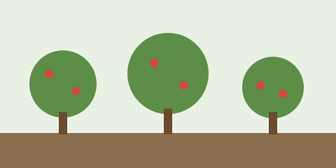

# Orchard notes

A **Markdown** window reads this file as it is typed, so a change shows
before it is saved. Links such as [ClojureScript](https://clojurescript.org)
open in the browser.

## What grows where

| Bed | Planted | Harvest |
| --- | --- | --- |
| North | Apples | September |
| South | Pears | October |

- Prune in late winter
- Water the young trees weekly
- Keep a note of each graft

```clojure
(defn ripe? [fruit]
  (>= (:sugar fruit) 0.8))
```



> The trees by the wall ripen first.
